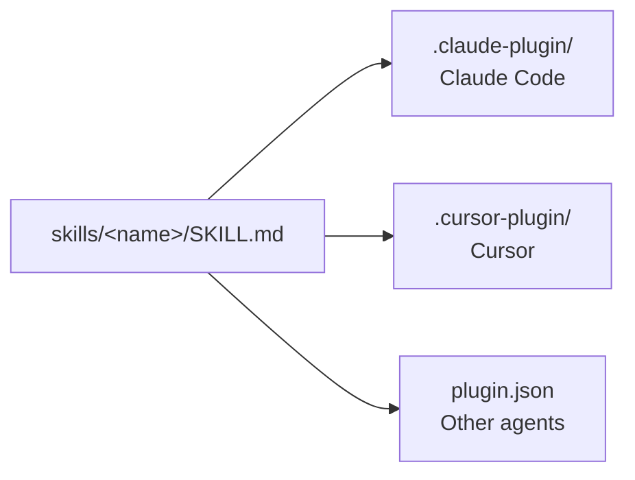

# It's a skills issue

Agent skills that work everywhere: one `skills/` folder, loaded by Claude Code, Cursor and any agent that reads the [Agent Skills](https://agentskills.io) format.



## Skills

| Skill | What it does |
|---|---|
| [`github-issues`](skills/github-issues/SKILL.md) | Writes short, scannable GitHub issues: callouts, task lists, the right Mermaid type, and HTML issue artifacts for extra context |

## Stack

Plain Markdown skills ([Agent Skills format](https://agentskills.io)), plus one manifest file per tool. No build step.

## Quick start

**Claude Code**

```sh
claude plugin marketplace add SeeWhatsOn/its-a-skills-issue   # or a local path
claude plugin install its-a-skills-issue@its-a-skills-issue
```

**Cursor:** link or clone the repo into `~/.cursor/plugins/local/`, then run **Developer: Reload Window**.

```sh
ln -s "$PWD" ~/.cursor/plugins/local/its-a-skills-issue
```

**Other agents** (Codex, Gemini CLI, …): point the agent's skills folder at `skills/`, e.g. `ln -s "$PWD/skills/github-issues" ~/.agents/skills/github-issues`.

## Adding a skill

1. Create `skills/<skill-name>/SKILL.md` with `name` and `description` frontmatter.
2. Put supporting files in `references/` (docs read on demand) and `assets/` (templates).
3. Bump `version` in all three manifests.
4. Run `claude plugin validate .`.

## Folder map

| Path | What's there |
|---|---|
| `skills/` | One folder per skill |
| `.claude-plugin/` | Claude Code manifest and marketplace file |
| `.cursor-plugin/` | Cursor manifest |
| `plugin.json` | Open-standard manifest for other agents |
