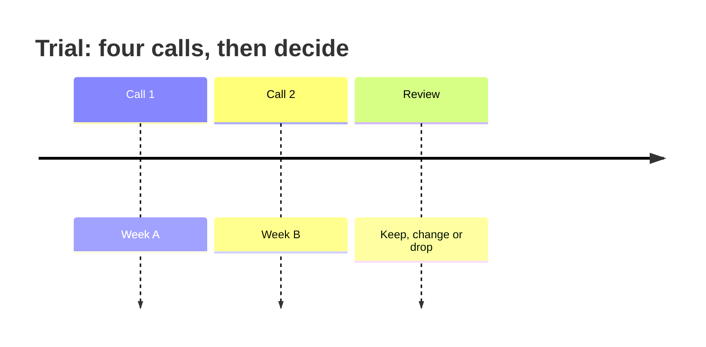

# GitHub Markdown cheat sheet (issues)

Read this when you need exact syntax beyond the basics in SKILL.md.

## Callouts (alerts)

```markdown
> [!NOTE]
> Useful context.

> [!TIP]
> Optional advice.

> [!IMPORTANT]
> Readers must act on this.

> [!WARNING]
> Risk or breaking change.

> [!CAUTION]
> Negative consequences of an action.
```

Use one or two per issue. When everything is highlighted, nothing stands out.

## Folds

```markdown
<details>
<summary>Full error log</summary>

```text
…log…
```

</details>
```

Leave a blank line after `<summary>…</summary>` and before `</details>`, or the Markdown inside won't render.

## Task lists

```markdown
- [ ] Not done
- [x] Done
- [ ] #123   ← shows the linked issue's title and status
```

## Code permalinks

`https://github.com/<owner>/<repo>/blob/<full-sha>/<path>#L10-L20`, placed on its own line, renders as a code snippet. Get the SHA with `git rev-parse HEAD`. Branch names won't render a snippet, and they go stale.

## Tables

- Put the column people compare across in the first column.
- Bold the row labels (`**For**`) to make them easy to scan.
- Keep cells short. If a cell needs a paragraph, it belongs in the body or a fold.

## Mermaid

Use a fenced block marked `mermaid`. Supported types include `flowchart`, `sequenceDiagram`, `stateDiagram-v2`, `timeline`, `gantt`, `classDiagram`, `erDiagram`, `pie`, `journey` and `gitGraph`.



Quote labels that contain punctuation: `A["Week A: Show & Shape"]`.

## Less common, occasionally useful

| Feature | Syntax |
|---|---|
| Keyboard keys | `<kbd>Ctrl</kbd>+<kbd>C</kbd>` |
| Footnotes | `Text[^1]` … `[^1]: Note` |
| Math | `$x^2$` inline, `$$…$$` block |
| Light/dark images | `<picture><source media="(prefers-color-scheme: dark)" srcset="…"></picture>` |
| Maps | A ```` ```geojson ```` block |
| Diffs | A ```` ```diff ```` block with `+` and `-` lines |

## What GitHub strips

`<script>`, `<style>`, `<iframe>`, inline `style=""` attributes and most `class` attributes are removed from issue bodies. For anything that needs real styling, use an HTML issue artifact.
